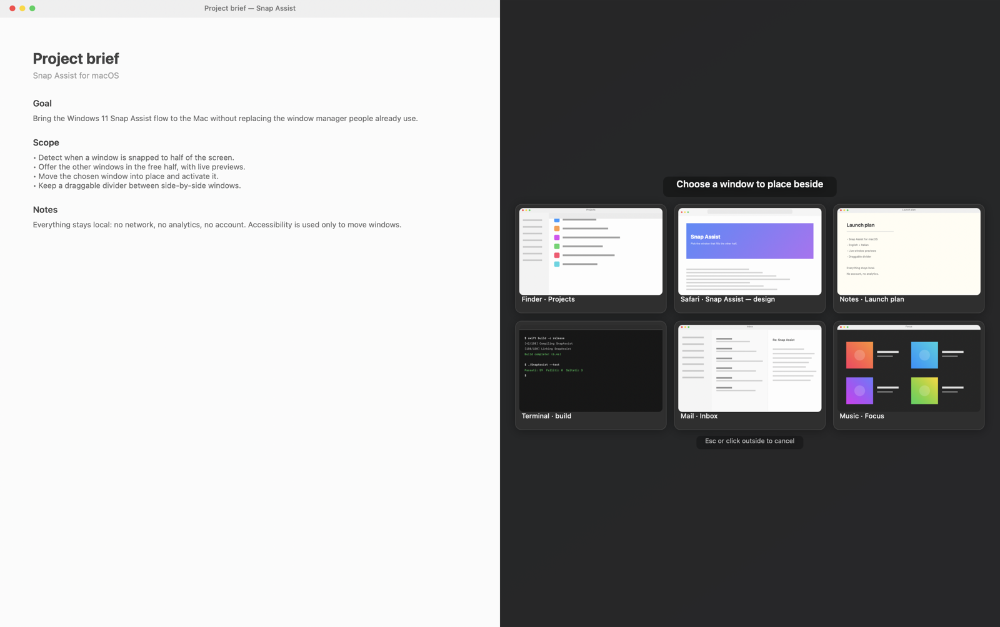

# Snap Assist

[English](README.md) | Italiano

Mini app di menu bar per macOS che porta su Mac il comportamento **Snap Assist** di Windows: quando una finestra viene agganciata a metà schermo (sinistra o destra), nella metà rimasta libera compare una griglia con le altre finestre aperte; un clic e la finestra scelta va a occupare quello spazio.

Funziona con qualsiasi metodo di snap: **Rectangle**, Magnet, le scorciatoie da tastiera, il trascinamento ai bordi o il tiling nativo di macOS.

**[Scarica per macOS](https://github.com/hellomoto8999/snap-assist/releases/latest)** · macOS 15+

## Requisiti

- macOS 15 o successivo

## Lingua

L'interfaccia segue la lingua di macOS: **italiano** se il sistema è in italiano, **inglese** per tutte le altre lingue. Non serve configurare nulla.

Se vuoi forzare una lingua solo per Snap Assist: Impostazioni di Sistema → Generali → Lingua e regione → App → Snap Assist.

## Permessi

Al primo avvio l'app apre un pannello **Permessi** con lo stato dei due permessi e i pulsanti che portano direttamente al pannello giusto di Impostazioni di Sistema. Mentre il pannello è aperto l'app compare anche nel Dock e in ⌘Tab; chiudendolo torna a vivere solo nella barra dei menu.

| Permesso | A cosa serve | Dove |
|---|---|---|
| **Accessibilità** | leggere posizione/dimensione della finestra in primo piano e spostare quella scelta | Impostazioni di Sistema → Privacy e sicurezza → Accessibilità |
| **Registrazione schermo** | catturare le miniature delle finestre nel pannello di scelta | Impostazioni di Sistema → Privacy e sicurezza → Registrazione schermo |

Senza Accessibilità l'app non può funzionare. Senza Registrazione schermo funziona lo stesso, ma al posto delle anteprime mostra l'icona dell'app. Dopo aver concesso la Registrazione schermo può essere necessario riavviare l'app (pulsante **Riavvia Snap Assist** nel pannello o nel menu).

> Se dopo una ricompilazione i permessi sembrano "dimenticati", controlla di aver creato la firma stabile con `./scripts/setup-signing.sh`: con la firma ad-hoc il permesso va riconcesso a ogni build.

## Uso

1. Aggancia una finestra a sinistra (o a destra) con Rectangle o trascinandola al bordo.
2. Dopo circa mezzo secondo la metà libera si scurisce e mostra le altre finestre.
3. Clicca quella da affiancare: viene spostata, ridimensionata e portata in primo piano.
4. `Esc` o un clic fuori dal pannello annullano.

Le finestre sono ordinate dalla più in primo piano alla più indietro, come in Windows. Sono escluse le finestre dell'app stessa e quella appena agganciata. Il pannello compare ogni volta che una finestra viene **appena** agganciata a metà schermo, anche se l'altra metà è già occupata da un'altra finestra; un semplice clic su una finestra già affiancata non lo riapre.

Per avviarla al login: Impostazioni di Sistema → Generali → Elementi login → «+» e scegli `SnapAssist.app`.

### Barra tra le due finestre

Quando due finestre occupano le due metà dello stesso schermo, sul confine c'è una barra verticale che permette di ridimensionarle insieme.

- La barra **compare solo quando avvicini il puntatore al confine** (entro circa 30 punti) e una delle due finestre è in primo piano. Non resta sopra alle altre app e non copre il resto dello schermo.
- Passandoci sopra appare una piccola maniglia con tre puntini; il cursore diventa orizzontale e, trascinando, entrambe le finestre si ridimensionano mantenendo altezza e bordi esterni (minimo 200 punti ciascuna).
- Resta anche dopo aver spostato il confine (es. 60/40), finché le due finestre restano affiancate e a tutta altezza.
- Ogni schermo ha la sua barra, se ci sono coppie affiancate su entrambi.
- Si nasconde quando apri il pannello di scelta, quando le finestre non sono più affiancate o quando usi un'altra app.
- Si può disattivare dal menu: **Barra di ridimensionamento tra finestre affiancate**.

## Limiti noti

- Le finestre di app che non consentono il ridimensionamento programmatico (alcune preferenze di sistema, alcuni pannelli) non si spostano: l'app emette un suono.
- Le finestre su altri Space non sono proposte (sono proposte quelle visibili).
- Con Stage Manager attivo i frame sono sfalsati e il rilevamento può non scattare.
- App non firmate/notarizzate: è un progetto personale, non passa dal Gatekeeper come un'app dello store.

## Disinstallazione

1. Esci da Snap Assist (menu → Esci).
2. Elimina `SnapAssist.app`.
3. Rimuovi eventualmente la voce da Accessibilità e Registrazione schermo in Impostazioni di Sistema.

Le preferenze restano in `~/Library/Preferences/com.frank.snapassist.plist`.
