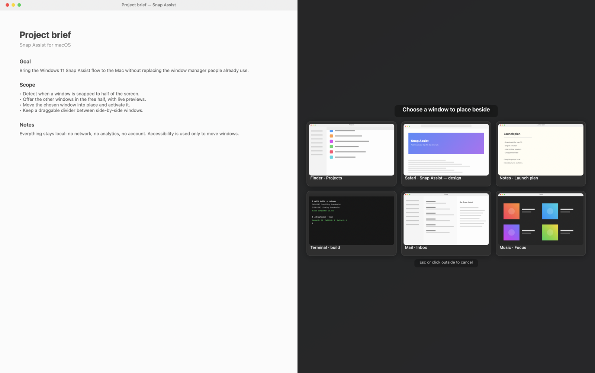
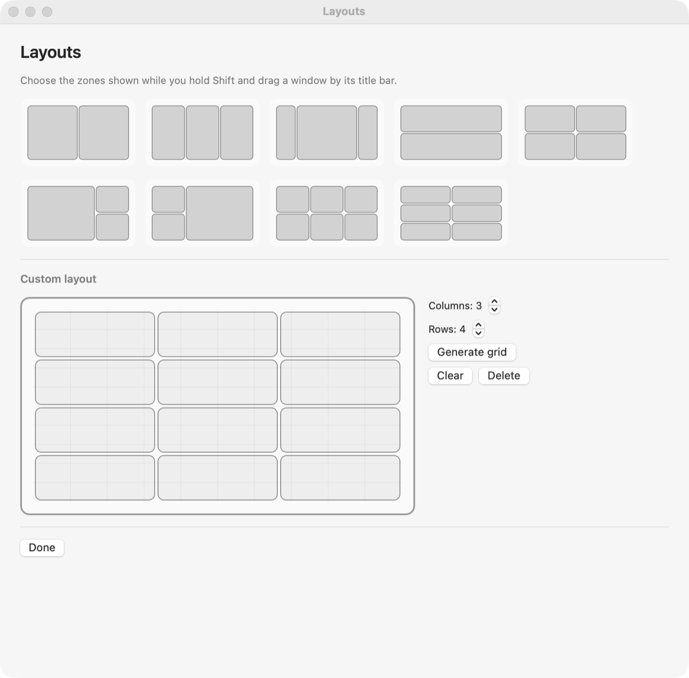

# Snap Assist

A tiny macOS menu bar app that brings Windows' **Snap Assist** to the Mac. Snap a window to a half of the screen and the free half shows a grid of your other open windows; one click and the chosen window fills that space.

Works with any snapping method: **Rectangle**, Magnet, keyboard shortcuts, dragging to the edge, or macOS native tiling.

**[Download for macOS](https://github.com/hellomoto8999/snap-assist/releases/latest)** · macOS 15+

English | [Italiano](README.it.md)

## Requirements

- macOS 15 or later

## Language

The UI follows the macOS language: **English** by default, **Italian** when the system is in Italian. Nothing to configure.

To force a language for Snap Assist only: System Settings → General → Language & Region → Apps → Snap Assist.

## Permissions

On first launch the app opens a **Permissions** panel with the status of both permissions and buttons that jump straight to the right System Settings pane. While the panel is open the app also appears in the Dock and ⌘Tab; closing it returns the app to menu-bar-only mode.

| Permission | Why | Where |
|---|---|---|
| **Accessibility** | read the position/size of the frontmost window and move the chosen one | System Settings → Privacy & Security → Accessibility |
| **Screen Recording** | capture window thumbnails for the picker | System Settings → Privacy & Security → Screen Recording |

Without Accessibility the app cannot work. Without Screen Recording it still works, but shows app icons instead of previews. After granting Screen Recording you may need to restart the app (**Restart Snap Assist** in the panel or the menu).

> If permissions look "forgotten" after a rebuild, make sure you created the stable signing identity with `./scripts/setup-signing.sh`: with an ad-hoc signature the permission must be granted again on every build.

## Usage

1. Snap a window to the left (or right) half with Rectangle or by dragging it to the edge.
2. After about half a second the free half dims and shows your other windows.
3. Click the one to place beside it: it is moved, resized and brought to the front.
4. `Esc` or a click outside the panel cancels.

Windows are ordered from frontmost to backmost, like on Windows. The app's own windows and the window that was just snapped are excluded. The panel appears every time a window is **newly** snapped to a half or a **quarter**, even if the other half is already occupied by another window; simply clicking an already snapped window does not reopen it.

When you snap a window to a quarter, the picker appears in the first free adjacent quarter (top-right for a top-left window, and so on).

**Center with Control**: double-tap **Control** (or triple-tap, configured in Settings → Behavior) to center the focused window on its screen. Control used as a modifier (Ctrl+C, Ctrl+click, Ctrl+scroll) does not trigger it.

To launch at login: System Settings → General → Login Items → “+” and choose `SnapAssist.app`.

### Divider between the two windows

When two windows occupy two adjacent areas of the same screen — halves, quarters or a grid — a divider sits on the boundary and lets you resize both at once. It is vertical between side-by-side windows and horizontal between stacked ones.

- The bar **only appears when the pointer is right on the boundary** (within about 8 points), so it does not pop up while you use a sidebar or pass nearby. It does not float above other apps or cover the rest of the screen.
- Hovering it shows a small handle with three dots; the cursor becomes horizontal or vertical and dragging resizes both windows while keeping their outer edges (120 points minimum each).
- It stays after you move the split (e.g. 60/40), as long as the two windows remain adjacent.
- Each screen has its own bar when there are adjacent pairs on both.
- It hides when the picker opens, when the windows are no longer adjacent, or when another window covers the boundary.
- It can be disabled from the menu: **Resize divider between side-by-side windows**.

### Layouts (Shift + drag)

In **Settings → Layouts** choose a preset — halves, thirds, **center + sides**, rows, 2×2, main + stack, stack + main, 3×2, 2×3 — or build your own on the canvas: drag on an empty area to draw a zone, drag inside a zone to move it, drag its edges to resize it, and use **Delete** to remove it. **Generate grid** gives you a starting point.

Then hold **Shift** and drag a window by its title bar. The zones appear in an overlay; move over a zone and release to place the window there. The overlay is per screen, ignores mouse events, and the drag keeps working normally.

**Launch at login** is available in the same Settings window under Behavior (macOS may ask you to approve it in System Settings → General → Login Items).

## Known limitations

- Windows of apps that refuse programmatic resizing (some System Settings panes, some panels) are not moved: the app plays a beep.
- Windows on other Spaces are not offered (only visible windows are).
- With Stage Manager enabled frames are offset and detection may not fire.
- Not signed/notarized for distribution: this is a personal project, not a Mac App Store app.

## Uninstall

1. Quit Snap Assist (menu → Quit).
2. Delete `SnapAssist.app`.
3. Optionally remove its entry from Accessibility and Screen Recording in System Settings.

Preferences stay in `~/Library/Preferences/com.frank.snapassist.plist`.

## License

MIT — see [LICENSE](LICENSE).
